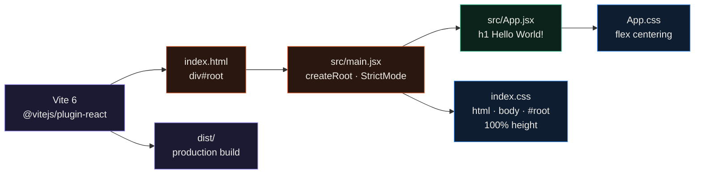

<div align="center">

# product-management-app

**The first version of my product manager: a Vite 6 and React 19 scaffold that renders one centered "Hello World!" page.**


</div>

This is where the product manager project started. I generated the official Vite React template, cut it down to a
single component and made the page fill the viewport, and stopped there. There is no routing, no product data and no
styling library yet.

[prodmanager](https://github.com/EllE961/prodmanager) is the newer, more complete version: about a week later I rebuilt
it on Create React App with React Router, React Bootstrap, a product table and a contact form. Go there for the
actual UI; this repo stays up as the starting point.

## Compared with prodmanager

| | product-management-app (this repo) | [prodmanager](https://github.com/EllE961/prodmanager) |
|---|---|---|
| First commit | 2025-05-22 | 2025-05-30 |
| Build tool | Vite 6.3 | Create React App (`react-scripts` 5) |
| React | 19.1 | 19.1 |
| Routing | none | React Router 7, three routes |
| UI library | none (two small CSS files) | React Bootstrap 2.10, Bootstrap Icons |
| Pages | one "Hello World!" heading | home, products table, contact form |
| Product data | none | two sample products in component state |

## How it works



`index.html` loads `src/main.jsx` as an ES module, which mounts `<App />` into `#root` inside `StrictMode`. The only
layout work is in CSS: `index.css` sets `html`, `body` and `#root` to full height with no margin, and `App.css` makes
the container a flexbox that centers the heading on both axes. Vite serves it with hot reload through
`@vitejs/plugin-react`, and ESLint 9 uses the template's flat config with the React Hooks and React Refresh plugins.

## Quickstart

```bash
git clone https://github.com/EllE961/product-management-app.git
cd product-management-app
npm ci
npm run dev      # dev server on http://localhost:5173
npm run build    # production build in dist/
npm run lint
```

On my machine (Node 22) the build transformed 30 modules into a 187.4 kB JavaScript bundle (58.9 kB gzip) in under a
second, and `npm run lint` reported no problems.

## Repository map

```text
index.html          page shell, loads src/main.jsx
src/
  main.jsx          mounts <App /> in StrictMode
  App.jsx           the Hello World! component
  App.css           flex centering for the container
  index.css         full-height html, body and #root
  assets/react.svg  template logo, no longer imported
public/vite.svg     favicon
vite.config.js      React plugin
eslint.config.js    ESLint 9 flat config from the template
docs/assets/        screenshot used in this README
```

## License

MIT, see [LICENSE](LICENSE).
